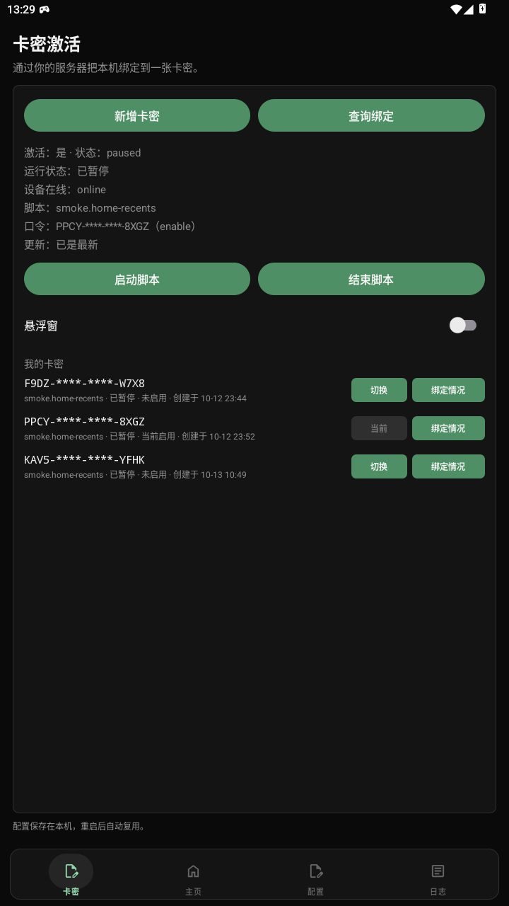
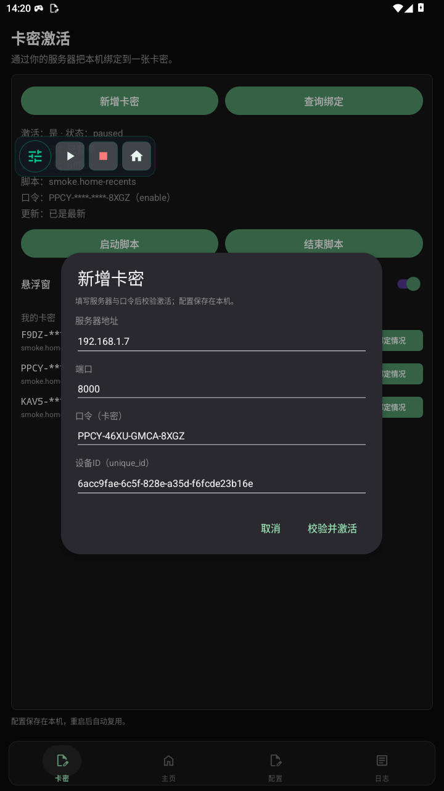
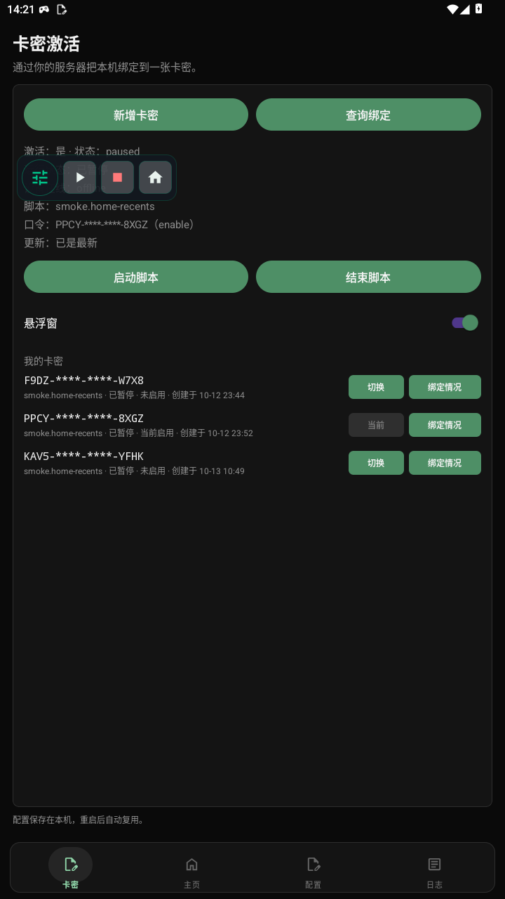
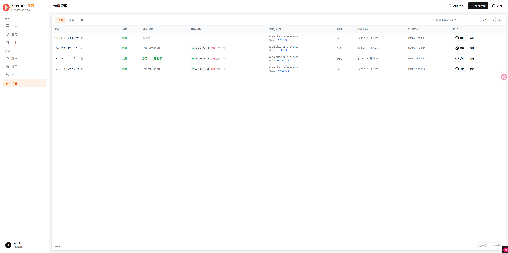
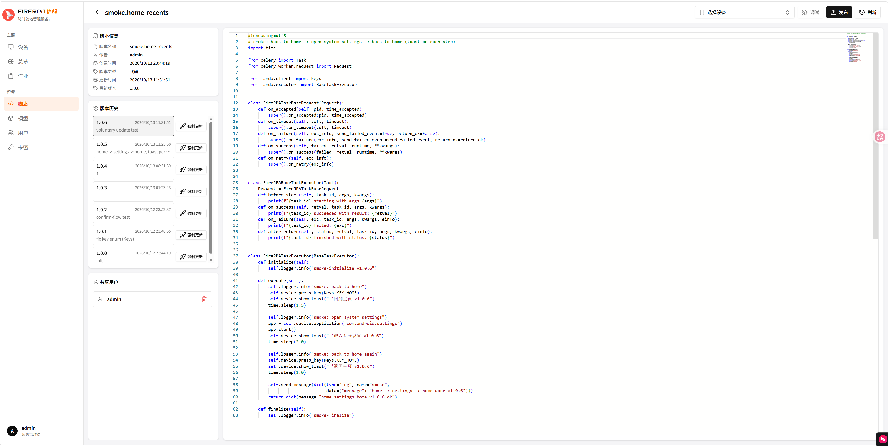
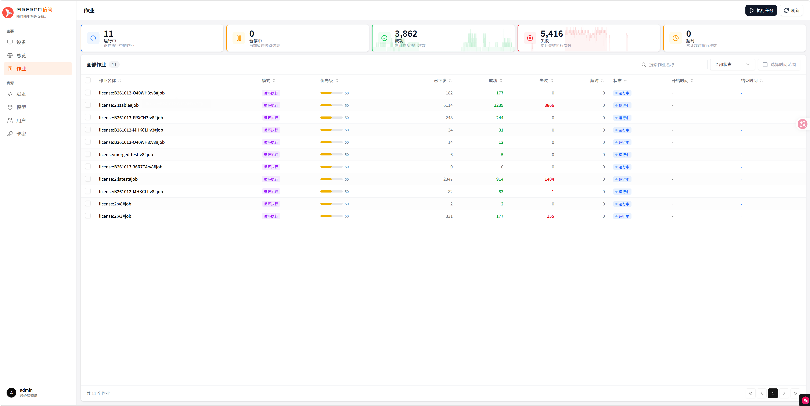
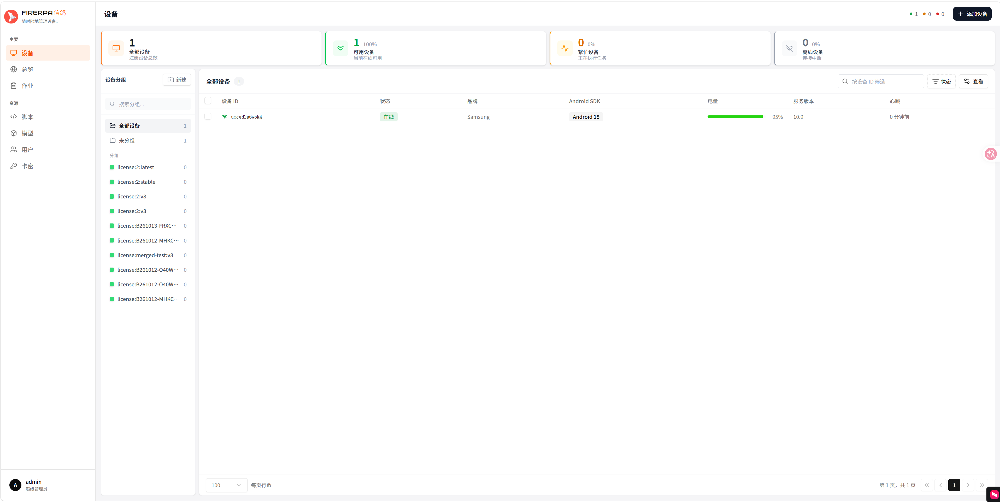
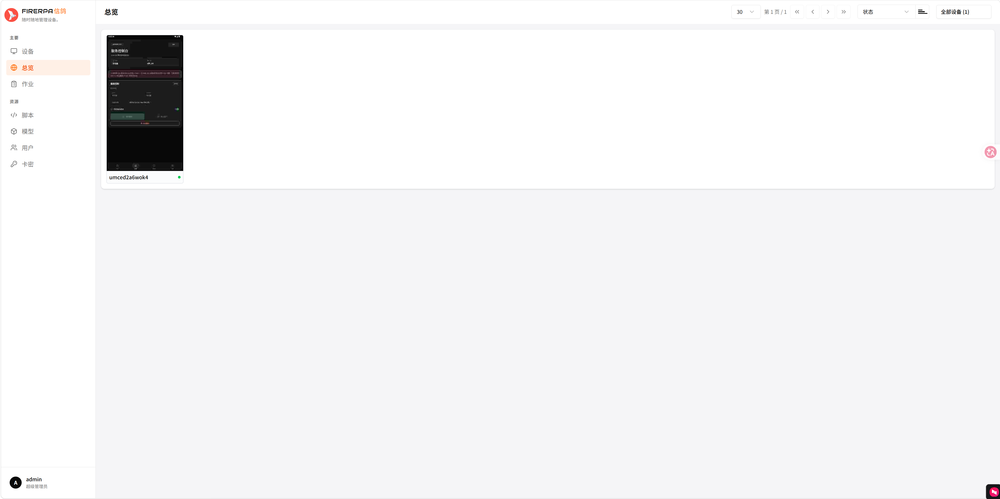
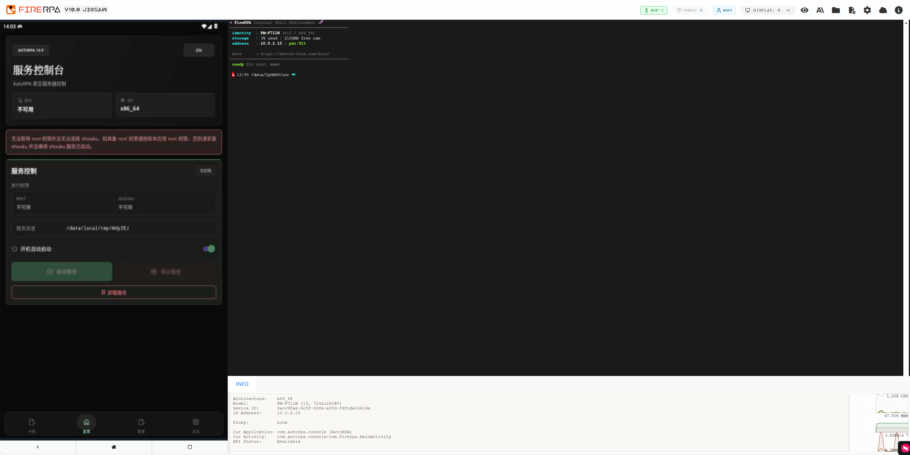
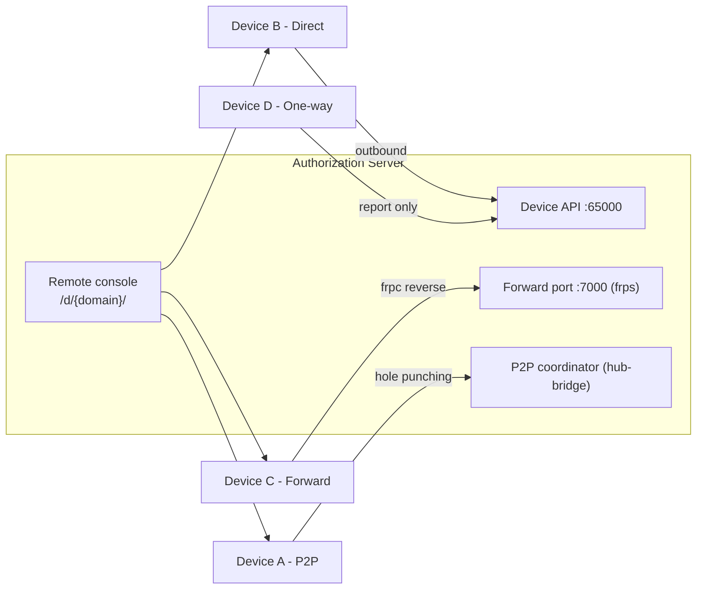

<div align="center">

**English | [简体中文](README.md)**

# AutoRPA

**Out-of-the-box Android RPA automation & control platform (client)**

Card-key licensing · Remote device management · UI automation · Floating overlay · Online updates


**📖 Device kernel (lamda) official documentation: [device-farm.com/docs/zh/quick-start](https://device-farm.com/docs/zh/quick-start)**

</div>

---

## Table of Contents

- [Introduction](#introduction)
- [System Components](#system-components)
- [Features](#features)
- [Screenshots](#screenshots)
- [Architecture](#architecture)
- [Remote Device Access Modes](#remote-device-access-modes)
- [End-to-End Flow](#end-to-end-flow)
- [Quick Start](#quick-start)
- [Server Side](#server-side)
- [AI Skill Package](#ai-skill-package)
- [FAQ](#faq)
- [Documentation](#documentation)
- [Build](#build)
- [Release](#release)
- [Project Layout](#project-layout)
- [License](#license)
- [Disclaimer](#disclaimer)

---

## Introduction

**AutoRPA** is an RPA (Robotic Process Automation) platform for Android devices, consisting of three parts:

| Part | Description | This repo |
|---|---|---|
| **AutoRPA App (client)** | User-facing Android app: card-key activation, script start/stop, floating overlay, auto-update | ✅ This repo (root) |
| **Authorization Server** | Self-hosted by the operator: card/batch/group management, script & version publishing, task scheduling, remote device console | ✅ This repo [`server/`](server/) (PIGEON fork) |
| **Device Kernel (lamda)** | On-device automation engine: UI automation, OCR, image matching, Frida, packet capture, etc. | [Open-source upstream](https://github.com/firerpa/lamda) |
| **AI Skill Package** | A skill for AI coding agents (OpenCode / Claude / Cursor…): inspect devices, validate UI selectors, generate and verify FIRERPA/lamda automation scripts | ✅ This repo [`skill/`](skill/) |

In one sentence:

> The operator **generates card keys in bulk** and publishes **automation scripts** → the user **activates the device with a card key** in the app → taps **Start Script** and the device executes tasks automatically.



The app handles *licensing + control + supervision*, while actual automation is executed by the on-device **lamda** kernel (running with root or Shizuku privileges).

## System Components

```
+--------------------------+          +--------------------------+          +--------------------------+
| AutoRPA App              |   auth   | Authorization Server     |  tasks   | Device Kernel (lamda)    |
| - card activation        | <------> | - cards / batches        | <------> | - UI automation / OCR    |
| - start/pause/stop       | control  | - scripts / versions     | execute  | - image match / Frida    |
| - overlay / updates      |          | - devices / console      |          | - capture / ADB ...      |
+--------------------------+          +--------------------------+          +--------------------------+
```

## Features

### Client (this repository)

| Feature | Description |
|---|---|
| 🔑 Card-key activation | `XXXX-XXXX-XXXX-XXXX` format (with checksum); supports lifetime and time-limited cards |
| 🔄 Card switching | Multiple cards per device, switch anytime; only one card runs at a time |
| ▶️ Run control | Start / pause / stop scripts; all actions apply to the device's currently enabled card |
| 🎈 Floating overlay | A draggable dot by default; tap to expand Start/Pause, Stop, Back-to-app buttons |
| 📦 Online update | One-tap in-app update after the server publishes a new version (never forced); server-initiated force update / rollback is also supported |
| 🔁 Device rebinding | Look up bound devices and unbind with just the card key (quota: total / daily / interval) |
| 📇 My Cards | Stable-sorted card list showing status, script, creation time and bindings |
| 🛡️ Security | Auto lockout after repeated wrong card keys; devices can be blocked by the operator (cards & scripts disabled) |
| 🩺 Self-healing | Kernel auto-restart on crash; kernel restart when device goes offline; screen kept awake to avoid injection failures |

### Server side (deployed by the operator)

| Module | Description |
|---|---|
| Card system | Bulk generation / disable / restore; batch grouping; unbind quotas (total / daily / interval) |
| Scripts & versions | Script management, version history, Job scheduling; publish / rollback; one-version-per-group isolation |
| Update policy | Normal publish never disturbs running devices (users opt in); "Force update" pushes to all devices / rolls back |
| Device management | Device list / groups / remote console / device blocking / audit log |
| Task channel | Real-time task dispatch, execution tracking, status reporting; job self-healing (keeps running version after pause) |
| Remote console | Browser access to the device WebUI: remote desktop, built-in terminal, ADB, files, capture, etc. |
| Admin console | Vue SPA (cards / jobs / devices / groups / audit), Chinese & English UI |

## Screenshots

### Client (AutoRPA App)

| Cards | Add card | Floating overlay |
|---|---|---|
|  |  |  |

### Server admin console

| Cards | Scripts & versions | Jobs |
|---|---|---|
|  |  |  |

| Devices | Remote overview | Remote console |
|---|---|---|
|  |  |  |

> The remote console shows the live device screen and provides the built-in terminal, ADB, packet capture and more (see "Remote Device Access Modes").

## Architecture

```
                       Authorization Server (Docker Compose, self-hosted)

  +--------------------------------------------------------------------+
  | nginx      : web console / API gateway / device proxy /d/<domain>/ |
  | Tornado    : admin API + license API + device API                  |
  | Celery     : job scheduling / task dispatch / periodic sync        |
  | frps       : device reverse access (forward mode)                  |
  | PgBouncer  : PostgreSQL connection pooling                         |
  +--------------+------------------+------------------+---------------+
                 |                  |                  |
        +--------v-------+ +--------v-------+ +--------v--------+
        | PostgreSQL     | | RabbitMQ       | | Redis x6        |
        | cards / devices| | task queue     | | cache / sessions|
        | jobs / audit   | | (Celery)       | | locks (1M2S+3L) |
        +----------------+ +----------------+ +-----------------+
```

| Component | Purpose | Default port |
|---|---|---|
| nginx + Tornado | Admin console / license API / device API gateway | `8000` |
| Device API | Device kernel reporting & attachment (`direct` mode) | `65000` |
| frps forward port | Device reverse registration (`forward` mode) | `7000` |
| PostgreSQL | Business data (cards, devices, scripts, jobs, audit…) | internal |
| RabbitMQ | Async task queue (Celery) | internal |
| Redis ×6 | Cache / sessions / distributed locks (1 master, 2 replicas, 3 locks) | internal |

> The server is a fork of the open-source [PIGEON](https://github.com/firerpa) project, extended with a complete **card-key licensing system** (batch grouping, version-isolated updates, unbind quotas, brute-force protection, device blocklist) and an admin console.

## Remote Device Access Modes

Devices can live behind different network conditions (public IP / NAT / no inbound access). The server supports **4 access modes** (selected per device in the admin console):

| Mode | How it works | When to use | Server can reach device |
|---|---|---|---|
| **P2P** (`p2p`) | Device and server perform hole punching via a coordination service (hub-bridge) | Both sides behind NAT, no public port | ✅ |
| **Direct** (`direct`) | Device kernel connects out to the server device API (no exposed ports) | Device can reach the server (LAN or public) | ✅ |
| **Forward** (`forward`) | Device-side client (frpc) registers its services on the server frps | Device behind NAT needing stable reverse access | ✅ |
| **One-way** (`oneway`) | Device only reports outbound status/results; server never dials in | Minimal setups: task dispatch + reporting only | ❌ |

Regardless of mode, the operator can open the **remote console** in a browser — `https://<server>/d/<device-domain>/` — to access the device kernel WebUI:

- **Remote desktop**: live screen + tap/swipe/type
- **Built-in terminal / ADB**: run shell commands on the device
- **Device HTTP proxy / packet capture**: debug network traffic
- **File manager / OCR / image matching / Frida** and more


> See the official docs for details: [Remote desktop](https://device-farm.com/docs/zh/remote-desktop) · [Built-in terminal](https://device-farm.com/docs/zh/built-in-terminal) · [Built-in ADB](https://device-farm.com/docs/zh/built-in-adb) · [Distributed deployment & NAT traversal](https://device-farm.com/docs/zh/distributed-deployment).

## End-to-End Flow

```mermaid
sequenceDiagram
    autonumber
    participant OP as Operator (admin console)
    participant SV as Authorization Server
    participant APP as AutoRPA App
    participant DM as Device Kernel (lamda)

    OP->>SV: Create script + upload version
    OP->>SV: Generate card keys in bulk (batch -> auto-create group)
    Note over SV: card <-> script is 1:1; devices join the batch group

    APP->>SV: verify(card, device_id)
    SV-->>APP: session_token (activated, not started)
    APP->>SV: resume (start script)
    SV->>SV: Device joins version group -> Job set to running
    SV-->>DM: Dispatch task (script + version)
    DM->>DM: Execute UI automation
    DM-->>SV: Logs / status reporting
    APP->>SV: poll /me (auto refresh every 5s)

    OP->>SV: Publish new version (users may self-update)
    APP->>SV: accept(update now) -> migrate to new version group
    OP->>SV: Force update (push to all / rollback)

    APP-->>APP: 5 wrong card attempts -> lockout; device blocked -> reject cards
```



## Quick Start

1. **Download & install**: grab the latest APK (`AutoRPA-vX.Y.apk`) from [Releases](../../releases) or the `release/` directory (Android 8.0+).
2. **Install the device kernel** (choose by root availability, see the official [Quick Start](https://device-farm.com/docs/zh/quick-start)):
   - Rooted: grant root → wait for the kernel to download & install → start the service;
   - Non-root: install & authorize Shizuku → wait for the kernel install → start the service.
3. **Activate**: open the app → **Cards** tab → Add Card → enter the card key from your operator.
4. **Start script**: tap **Start Script**; pause/stop from the app or the floating overlay.
5. Optional: enable the **Floating overlay** switch to control scripts from anywhere.

> Note: some devices require overlay/notification permissions; core automation needs root or Shizuku (see the official docs).

## Server Side

Deployed by the operator (single `docker compose up`), the server is responsible for:

| Responsibility | Description |
|---|---|
| Licensing | Card validation, binding management, unbind quotas, brute-force protection (5 failures → 10 min lockout), device blocklist |
| Organization | Batch = group: a same-named group is auto-created when generating cards; devices aggregate by batch group |
| Scheduling | Jobs maintained per "group + version"; real-time dispatch, execution tracking, status reporting |
| Versioning | One-version-per-group isolation; publishing never disturbs running devices (opt-in updates); force update pushes / rolls back all |
| Operations | Remote console, audit log, job self-healing (keeps the running version across pause/restart) |
| Admin console | Vue console: cards / batches / jobs / devices / groups / audit / app release management |

Deployment essentials:

> The server source lives in this repo under [`server/`](server/) (a PIGEON fork with the full card-licensing system and admin console).
> Note: the IP geolocation database `executor/IPDB.BIN` (~170 MB, over hosting per-file limits) is **not** distributed with this repo — place it into `server/executor/` before deploying.

```bash
# from the repository root
cd server && docker build -t pigeon-fork:1.0 .   # or: docker compose -f docker/docker-compose.yml build
cp docker/.env.example docker/.env               # edit domain, IPs and credentials as documented
docker compose -f docker/docker-compose.yml up -d
# then open http://<server-ip>:8000 (default account admin/pigeon — change it immediately)
```

## AI Skill Package

[`skill/`](skill/) contains a skill package for **AI coding agents** (OpenCode / Claude / Cursor…), enabling them to author and verify FIRERPA / lamda automation scripts:

| Item | Description |
|---|---|
| [`skill/firerpa/SKILL.md`](skill/firerpa/SKILL.md) | Skill definition & agent rules (produce reusable lamda Python scripts) |
| [`skill/firerpa/scripts/firerpa.py`](skill/firerpa/scripts/firerpa.py) | Unified CLI: connectivity checks, app prechecks, UI inspection, selector checks, tap/type actions |
| [`skill/firerpa/client/`](skill/firerpa/client/) | lamda Python client (`from lamda.client import *`) and gRPC protos |
| [`skill/firerpa/references/`](skill/firerpa/references/) | Offline copies of the official docs (llms-full.txt / reference.md) for AI retrieval |

Typical usage:

```bash
cd skill/firerpa
pip install -r requirements.txt

python3 scripts/firerpa.py device-info --host <device-ip>     # device / service info
python3 scripts/firerpa.py dump --host <device-ip> -o ui.xml  # dump the current UI tree
python3 scripts/firerpa.py app-current --host <device-ip>     # foreground app
# give the task + these outputs to your AI agent -> generate a reusable script -> verify via the CLI
```

> Recommended reading: kernel docs [Quick Start](https://device-farm.com/docs/zh/quick-start) and [API primer](https://device-farm.com/docs/zh/api-prepare).

## FAQ

**Q: "Device not attached to the server yet"?**  
The operator needs to attach the device on the server side (the app can report device info after first launch, or the operator configures an access token in the admin console).

**Q: Card key rejected?**  
Make sure the key is complete. After 5 consecutive failures the device is locked out (~10 minutes) — even correct keys are rejected during the lockout.

**Q: "Device blocked by administrator"?**  
Ask the operator to unblock it. While blocked, the device cannot use card keys or start scripts.

**Q: I tapped "Cancel" on the update dialog — will it pop up again?**  
The same version is only prompted once; a higher version published later will prompt again. "Download" opens the browser download.

**Q: Moving to a new device?**  
Open **Query Bindings**, enter the card key, and unbind the old device — then activate on the new one (unbind counts are limited by the operator).

**Q: Kernel install / service start failures?**  
Check the official [FAQ](https://device-farm.com/docs/zh/faq) first; some OEM ROMs require manually allowing auto-start / background execution.

## Documentation

### Device kernel (lamda / FIRERPA) official docs

| Doc | Link |
|---|---|
| 🚀 **Quick Start (must read)** | https://device-farm.com/docs/zh/quick-start |
| Basics / FAQ | https://device-farm.com/docs/zh/basics · https://device-farm.com/docs/zh/faq |
| Remote desktop / Terminal / Built-in ADB | https://device-farm.com/docs/zh/remote-desktop · /built-in-terminal · /built-in-adb |
| Script development: API primer | https://device-farm.com/docs/zh/api-prepare |
| UI automation / OCR / Image matching | https://device-farm.com/docs/zh/ui-basics · /ocr · /image-match |
| MCP / Agent integration | https://device-farm.com/docs/zh/model-extension |
| Distributed deployment & NAT traversal | https://device-farm.com/docs/zh/distributed-deployment |
| Upstream source code | https://github.com/firerpa/lamda |

## Build

Requirements: JDK 17+, Android SDK (compileSdk 34).

```bash
./gradlew :app:assembleDebug     # debug build
./gradlew :app:assembleRelease   # release build (requires signing config)
# outputs: app/build/outputs/apk/{debug,release}/...
```

**Signing**: the release build reads `keystore.properties` at the repo root:

```properties
storeFile=autorpa-release.jks
storePassword=******
keyAlias=autorpa
keyPassword=******
```

The keystore is **not** committed (see `.gitignore`). Use your own key when building your own release; **the applicationId `com.autorpa.console` and the signing key must never change** for published versions — otherwise existing users cannot update in place.

**Version name**: generated from `git describe --tags --always` (e.g. tag `v1.4` → version `1.4`). Just tag to release.

## Release

- Version tag: `vX.Y` (e.g. `v1.4`)
- Release contents: source + `release/AutoRPA-vX.Y.apk`
- Download URL example: `https://gitee.com/suyibk/autorpa/raw/master/release/AutoRPA-v1.4.apk`
- Recommended: also attach the APK to a Gitee "Release" for a stable download page
- After publishing, update the app version (version + direct URL) in the admin console so older installs receive the update prompt

## Project Layout

```
app/
├── app/src/main/java/com/firerpa/       # main project (Kotlin)
│   ├── license/                         # cards: activation / switching / status / overlay / self-heal
│   ├── overlay/                         # floating overlay service (dot + control panel)
│   ├── data/                            # local preferences (AppPrefs)
│   ├── service/ ...                     # kernel installation & management (download / start / remove)
│   └── ui/ ...                          # home / config / log pages
├── app/src/main/res/                    # resources (i18n: zh / en)
├── server/                              # authorization server source (PIGEON fork: cards/groups/jobs/versions/console)
├── skill/                               # AI skill package (FIRERPA/lamda script authoring for AI agents)
├── release/                             # released APKs (committed with tags)
├── docs/                                # screenshots and doc assets
└── keystore.properties                  # signing config (not committed)
```

## License

This project is released under the [MIT License](LICENSE) (Copyright © 2026 歪比巴卜). The lamda / FIRERPA device kernel and its documentation belong to their upstream project.

## Disclaimer

This project is intended for **authorized** device automation and personal productivity only. Please comply with device vendors' and platforms' terms of service, and do not use it for any illegal purposes.

---

<div align="center">
<sub>Built on the open-source <a href="https://device-farm.com/docs/zh/quick-start">FIRERPA / lamda</a> ecosystem · Issues & feedback welcome</sub>
</div>
