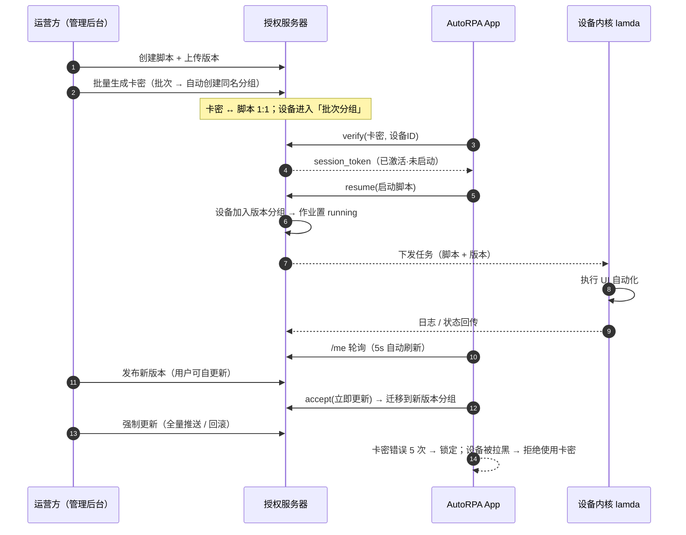
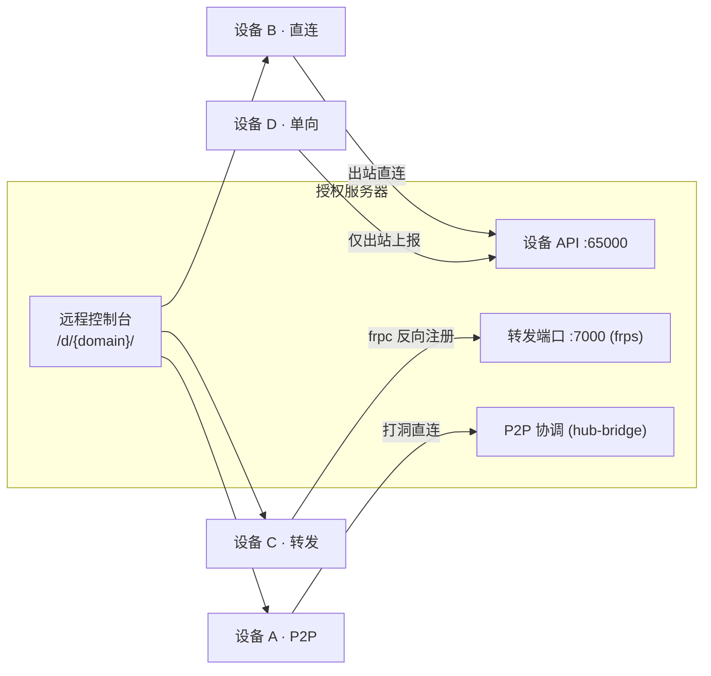

<div align="center">

**简体中文 | [English](README.en.md)**

# AutoRPA

**开箱即用的安卓 RPA 自动化控制平台（客户端）**

卡密授权 · 远程设备管控 · UI 自动化 · 悬浮窗控制 · 在线更新


**📖 设备内核（lamda）官方文档：[device-farm.com/docs/zh/quick-start](https://device-farm.com/docs/zh/quick-start)**

</div>

---

## 目录

- [项目简介](#项目简介)
- [系统组成](#系统组成)
- [功能特性](#功能特性)
- [界面截图](#界面截图)
- [系统架构](#系统架构)
- [远程安卓设备接入机制](#远程安卓设备接入机制)
- [完整业务流程图](#完整业务流程图)
- [快速开始](#快速开始)
- [服务端说明](#服务端说明)
- [AI 技能包](#ai-技能包)
- [常见问题](#常见问题)
- [相关文档](#相关文档)
- [构建](#构建)
- [发布规范](#发布规范)
- [目录结构](#目录结构)
- [开源许可](#开源许可)
- [免责声明](#免责声明)

---

## 项目简介

**AutoRPA** 是一套面向安卓设备的 RPA（Robotic Process Automation）自动化控制平台，由三部分组成：

| 组成 | 说明 | 本仓库 |
|---|---|---|
| **AutoRPA App（客户端）** | 用户侧的安卓应用：卡密激活、脚本启停、悬浮窗控制、自动更新 | ✅ 本仓库（根目录） |
| **授权服务器（服务端）** | 运营方自部署：卡密/批次/分组管理、脚本与版本发布、任务调度、设备远程控制台 | ✅ 本仓库 [`server/`](server/)（PIGEON 二开） |
| **设备内核（lamda）** | 运行在设备上的自动化执行引擎：UI 自动化、OCR、图像匹配、Frida、抓包等 | [开源上游](https://github.com/firerpa/lamda) |
| **AI 技能包（Agent Skill）** | 供 AI 编程助手（OpenCode / Claude / Cursor 等）使用的 FIRERPA/lamda 脚本编写技能：设备巡检、UI 选择器校验、脚本生成与验证 | ✅ 本仓库 [`skill/`](skill/) |

整体流程一句话：

> 运营方在后台**批量生成卡密**并下发**自动化脚本** → 用户在 App 内**输入卡密激活设备** → 一键**启动脚本**，设备自动执行任务。


App 负责「授权 + 控制 + 守护」，真正的自动化执行由设备端 lamda 内核完成（支持 root / Shizuku 多级权限）。

## 系统组成

```
┌─────────────────────┐        ┌──────────────────────────┐       ┌─────────────────────┐
│ AutoRPA App          │  授权   │ 授权服务器（自部署）        │  任务  │ 设备内核 lamda        │
│ ─ 卡密激活 / 切换      │ ◀────▶ │ ─ 卡密 / 批次 / 分组        │ ◀───▶ │ ─ UI 自动化 / OCR     │
│ ─ 启动 / 暂停 / 结束   │  控制   │ ─ 脚本 / 版本 / 作业调度     │  执行  │ ─ 图像匹配 / Frida    │
│ ─ 悬浮窗 / 在线更新    │        │ ─ 设备管理 / 远程控制台      │       │ ─ 抓包 / 内置 ADB 等   │
└─────────────────────┘        └──────────────────────────┘       └─────────────────────┘
```

## 功能特性

### 客户端（本仓库）

| 功能 | 说明 |
|---|---|
| 🔑 卡密激活 | `XXXX-XXXX-XXXX-XXXX` 格式卡密（含校验位），支持永久卡 / 有效期卡 |
| 🔄 卡密切换 | 一设备可绑定多张卡密，随时切换；同一时刻仅一张卡运行 |
| ▶️ 运行控制 | 启动 / 暂停 / 结束脚本；所有操作以「设备当前启用的卡」为准 |
| 🎈 悬浮窗面板 | 默认小圆点（可拖动），点击展开 启动/暂停、结束、回主页 三个图标按钮 |
| 📦 在线更新 | 后台发布新版本后 App 内一键更新（不强制）；也支持后台强制更新/回滚 |
| 🔁 换机解绑 | 凭卡密即可查询绑定设备并解绑（可配置解绑次数/间隔限额） |
| 📇 我的卡密 | 固定排序的卡密列表；状态、脚本、创建时间、绑定情况一目了然 |
| 🛡️ 安全防护 | 卡密错误次数超限自动锁定；设备可被后台拉黑（拉黑后禁用卡密与脚本） |
| 🩺 自动守护 | 内核异常退出自动拉起；设备离线自动重启内核；屏幕常亮防止注入失败 |

### 服务端（运营方部署）

| 模块 | 说明 |
|---|---|
| 卡密系统 | 批量生成 / 禁用 / 恢复；批次分组；解绑配额（总次数/每日/间隔） |
| 脚本与版本 | 脚本管理、版本历史、作业（Job）调度；发布 / 回滚；一组一版本隔离 |
| 更新策略 | 正常发布不影响在线设备（用户可自选更新）；「强制更新」全量推送/回滚 |
| 设备管理 | 设备列表 / 分组 / 远程控制台 / 拉黑 / 审计日志 |
| 任务通道 | 实时任务下发、执行跟踪、状态回传；作业自愈（暂停恢复后保持原版本） |
| 远程控制台 | 浏览器直连设备 WebUI：远程桌面、内置终端、ADB、文件、抓包等 |
| 管理界面 | Vue 单页控制台（卡密/作业/设备/分组/审计），支持中英文 |

## 界面截图

### 客户端（AutoRPA App）

| 卡密页 | 新增卡密 | 悬浮窗面板 |
|---|---|---|
|  |  |  |

### 服务端管理控制台

| 卡密管理 | 脚本与版本 | 作业列表 |
|---|---|---|
|  |  |  |

| 设备管理 | 设备总览（远控入口） | 远程控制台 |
|---|---|---|
|  |  |  |

> 远程控制台里可以看到设备的实时画面，并使用内置终端、ADB、抓包等能力（见下文「远程安卓设备接入机制」）。

## 系统架构

```
                          授权服务器（Docker Compose 自部署）
        ┌─────────────────────────────────────────────────────────────────┐
        │  nginx（Web 控制台 / API 网关 / 设备反向代理 /d/<domain>/）          │
        │    ├── Tornado 应用服务（管理 API + 授权 API + 设备 API）            │
        │    ├── Celery Worker（作业调度 / 任务下发 / 周期同步）                │
        │    ├── frps（设备反向接入）、PgBouncer（数据库连接池）                 │
        └───────┬───────────────┬───────────────┬─────────────────────────┘
                │               │               │
        ┌───────▼─────┐  ┌──────▼──────┐  ┌─────▼───────┐
        │ PostgreSQL  │  │  RabbitMQ   │  │   Redis     │
        │ 卡密/设备/作业 │  │  任务队列    │  │ 缓存 + 分布式锁 │
        └─────────────┘  └─────────────┘  └─────────────┘
```

| 组件 | 用途 | 端口（默认） |
|---|---|---|
| nginx + Tornado | 管理控制台 / 授权 API / 设备 API 网关 | `8000` |
| 设备直连 API | 设备内核上报与接入（direct 模式） | `65000` |
| frps 转发端口 | 设备反向注册（forward 模式） | `7000` |
| PostgreSQL | 业务数据（卡密、设备、脚本、作业、审计…） | 内部 |
| RabbitMQ | 异步任务队列（Celery） | 内部 |
| Redis ×6 | 缓存 / 会话 / 分布式锁（1 主 2 从 + 3 锁） | 内部 |

> 服务端基于开源项目 [PIGEON](https://github.com/firerpa) 二次开发，新增完整的**卡密授权体系**（批次分组、版本隔离更新、解绑配额、防爆破、设备黑名单）与卡密管理控制台。

## 远程安卓设备接入机制

设备可能处于不同网络环境（公网 / 内网 NAT / 无法反向访问），服务端提供 **4 种接入模式**（设备管理端按设备选择）：

| 模式 | 原理 | 适用场景 | 服务器可反向控制 |
|---|---|---|---|
| **P2P**（`p2p`） | 设备与服务器通过协调服务（hub-bridge）打洞，点对点直连 | 双方都在 NAT 后，无公网端口 | ✅ |
| **直连**（`direct`） | 设备内核直接访问服务器设备 API（出站连接、无需暴露端口） | 设备可访问服务器地址（内网同段/公网） | ✅ |
| **转发**（`forward`） | 设备侧内网穿透（frpc）把自身服务反向注册到服务器 frps | 设备在 NAT 后，希望稳定反向访问 | ✅ |
| **单向**（`oneway`） | 设备仅出站上报状态/结果，服务器不主动连设备 | 极简环境，仅需要任务下发与回传 | ❌ |

无论采用哪种模式，运营方都可以在浏览器打开**远程控制台**（`https://<服务器>/d/<设备domain>/`）直接访问设备内核 WebUI，使用：

- **远程桌面**：实时画面 + 点击/滑动/输入
- **内置终端 / ADB**：命令行操作设备
- **设备 HTTP 代理 / 抓包**：调试网络请求
- **文件管理 / OCR / 图像匹配 / Frida** 等调试能力


> 设备内核各能力的详细说明见官方文档：[远程桌面](https://device-farm.com/docs/zh/remote-desktop)、[内置终端](https://device-farm.com/docs/zh/built-in-terminal)、[内置 ADB](https://device-farm.com/docs/zh/built-in-adb)、[分布式及内网穿透](https://device-farm.com/docs/zh/distributed-deployment)。

## 完整业务流程图





## 快速开始

1. **下载安装**：从 [Releases](../../releases) 或 `release/` 目录下载最新 APK（`AutoRPA-vX.Y.apk`），安装到安卓设备（Android 8.0+）。
2. **安装设备内核**：按设备是否 Root 选择安装方式（参考官方文档 [快速开始](https://device-farm.com/docs/zh/quick-start)）：
   - 有 Root：授权 root → 等待内核下载安装 → 启动服务；
   - 无 Root：安装 Shizuku 并授权 → 等待内核安装 → 启动服务。
3. **激活卡密**：打开 App →「卡密」页 → 新增卡密 → 输入运营方提供的卡密。
4. **启动脚本**：点击「启动脚本」；暂停/结束在 App 或悬浮窗操作。
5. 可选：打开「悬浮窗」开关，任何界面都能用小圆点控制脚本。

> 提示：部分设备需要授予悬浮窗/通知权限；核心自动化能力需要 root 或 Shizuku（详见官方文档）。

## 服务端说明

服务端由运营方自行部署（Docker Compose，一条命令起全栈），承担以下职责：

| 职责 | 说明 |
|---|---|
| 授权 | 卡密校验、绑定管理、解绑配额、防爆破（错误 5 次锁定 10 分钟）、设备黑名单 |
| 组织 | 批次 = 分组：生成卡密时自动创建同名分组；设备按批次分组聚合管理 |
| 调度 | 作业（Job）按「分组 + 版本」维护；任务实时下发、执行跟踪、状态回传 |
| 版本 | 一组一版本隔离；发布不打扰在线设备（用户自选更新）；强制更新全量推送/回滚 |
| 运维 | 设备远程控制台、审计日志、作业自愈（暂停/重启后恢复原版本） |
| 控制台 | Vue 管理界面：卡密 / 批次 / 作业 / 设备 / 分组 / 审计 / App 版本发布 |

部署要点：

> 服务端源码位于本仓库 [`server/`](server/)（PIGEON 二开，含完整卡密授权体系与管理控制台）。
> 注意：IP 地理库 `executor/IPDB.BIN`（约 170MB，超代码托管单文件限制）**不随仓库分发**，部署前请将其放入 `server/executor/`。

```bash
# 在仓库根目录
cd server && docker build -t pigeon-fork:1.0 .   # 或：docker compose -f docker/docker-compose.yml build
cp docker/.env.example docker/.env               # 按说明修改（域名、IP、口令）
docker compose -f docker/docker-compose.yml up -d
# 浏览器访问 http://<服务器IP>:8000（默认账号 admin/pigeon，请立即修改）
```

## AI 技能包

[`skill/`](skill/) 是一个面向 **AI 编程助手**（OpenCode / Claude / Cursor 等）的技能包，用于让 AI 参与编写与验证 FIRERPA / lamda 自动化脚本：

| 内容 | 说明 |
|---|---|
| [`skill/firerpa/SKILL.md`](skill/firerpa/SKILL.md) | 技能定义与 Agent 使用规则（产出可复用的 lamda Python 脚本） |
| [`skill/firerpa/scripts/firerpa.py`](skill/firerpa/scripts/firerpa.py) | 统一 CLI：连通性检查、应用预检、UI 巡检、选择器校验、点击/输入等 |
| [`skill/firerpa/client/`](skill/firerpa/client/) | lamda Python 客户端（`from lamda.client import *`）与 gRPC 协议定义 |
| [`skill/firerpa/references/`](skill/firerpa/references/) | 官方文档离线全文（llms-full.txt / reference.md），供 AI 检索 |

典型用法：

```bash
cd skill/firerpa
pip install -r requirements.txt

python3 scripts/firerpa.py device-info --host <设备IP>     # 设备/服务信息
python3 scripts/firerpa.py dump --host <设备IP> -o ui.xml   # 抓取当前 UI 树
python3 scripts/firerpa.py app-current --host <设备IP>      # 当前前台应用
# 将任务描述 + 上述输出交给 AI → 生成可复用脚本 → 再用 CLI 校验
```

> 配套阅读：设备内核文档 [快速开始](https://device-farm.com/docs/zh/quick-start) 与 [API 入门](https://device-farm.com/docs/zh/api-prepare)。

## 常见问题

**Q：提示「设备尚未接入服务器」？**  
运营方需要在服务端完成设备接入（App 首次安装后可自动上报设备信息，或由运营方在后台配置接入令牌）。

**Q：输入卡密提示错误？**  
检查卡密是否输入完整；连续错误 5 次会进入锁定（约 10 分钟），期间即使卡密正确也会被拒绝。

**Q：提示「设备已被管理员拉黑」？**  
请联系运营方解除拉黑。拉黑状态下无法使用卡密、无法启动脚本。

**Q：App 更新提示点了「取消」还会再弹吗？**  
同一版本只提示一次；后台发布更高版本时会再次提示。点击「前往下载」跳转浏览器下载新版本。

**Q：换设备了怎么办？**  
在「查询绑定」中输入卡密，将旧设备解绑后即可在新设备激活（解绑次数由运营方限制）。

**Q：内核安装 / 服务启动失败？**  
优先查阅官方文档 [问题汇总](https://device-farm.com/docs/zh/faq)；部分机型需手动允许自启动/后台运行。

## 相关文档

### 设备内核（lamda / FIRERPA）官方文档

| 文档 | 链接 |
|---|---|
| 🚀 **快速开始（必读）** | https://device-farm.com/docs/zh/quick-start |
| 基础知识 / 问题汇总 | https://device-farm.com/docs/zh/basics · https://device-farm.com/docs/zh/faq |
| 远程桌面 / 内置终端 / 内置 ADB | https://device-farm.com/docs/zh/remote-desktop · /built-in-terminal · /built-in-adb |
| 脚本开发：API 入门 | https://device-farm.com/docs/zh/api-prepare |
| UI 自动化 / OCR / 图像匹配 | https://device-farm.com/docs/zh/ui-basics · /ocr · /image-match |
| MCP / Agent 接入 | https://device-farm.com/docs/zh/model-extension |
| 分布式部署与内网穿透 | https://device-farm.com/docs/zh/distributed-deployment |
| 上游开源代码 | https://github.com/firerpa/lamda |

## 构建

环境要求：JDK 17+、Android SDK（compileSdk 34）。

```bash
./gradlew :app:assembleDebug     # 调试包
./gradlew :app:assembleRelease   # 正式包（需签名配置）
# 产物：app/build/outputs/apk/{debug,release}/…
```

**签名说明**：Release 构建读取根目录 `keystore.properties`：

```properties
storeFile=autorpa-release.jks
storePassword=******
keyAlias=autorpa
keyPassword=******
```

密钥文件不入库（见 `.gitignore`）。自行构建发布版时请使用你自己的密钥；**正式版本的包名 `com.autorpa.console` 与签名不可更换**，否则用户无法覆盖安装升级。

**版本号**：由 `git describe --tags --always` 自动生成（如 `v1.4` → 版本号 `1.4`），发布时打 tag 即可。

## 发布规范

- 版本 tag：`vX.Y`（如 `v1.4`）
- 发布内容：源码 + `release/AutoRPA-vX.Y.apk`
- 用户下载地址示例：`https://gitee.com/suyibk/autorpa/raw/master/release/AutoRPA-v1.4.apk`
- 建议同时在 Gitee「发行版」中上传 APK，获得固定下载页
- 发版后到管理后台更新「App 版本」（版本号 + 直链），老用户即可收到更新提示

## 目录结构

```
app/
├── app/src/main/java/com/firerpa/       # 主工程（Kotlin）
│   ├── license/                         # 卡密页：激活/切换/状态/悬浮窗/自愈
│   ├── overlay/                         # 悬浮窗服务（小圆点 + 控制面板）
│   ├── data/                            # 本地配置（AppPrefs）
│   ├── service/ …                       # 内核实装与管理（下载/启动/卸载）
│   └── ui/ …                            # 主页/配置/日志页
├── app/src/main/res/                    # 资源（多语言：zh / en）
├── server/                              # 授权服务器源码（PIGEON 二开：卡密/分组/作业/版本/控制台）
├── skill/                               # AI 技能包（FIRERPA/lamda 脚本编写，供 AI 助手使用）
├── release/                             # 发布版 APK（随 tag 提交）
├── docs/                                # 截图等文档资源
└── keystore.properties                  # 签名配置（不入库）
```

## 开源许可

本项目基于 [MIT License](LICENSE) 开源（Copyright © 2026 歪比巴卜）。设备内核 lamda / FIRERPA 相关能力与文档版权归其上游项目所有。

## 免责声明

本项目仅用于**合法授权**场景下的设备自动化管理与个人效率提升。请遵守设备厂商与相关平台的服务条款，勿用于任何违反法律法规的用途。

---

<div align="center">
<sub>基于 <a href="https://device-farm.com/docs/zh/quick-start">FIRERPA / lamda</a> 开源生态二次开发 · 交流/反馈请提 Issue</sub>
</div>
